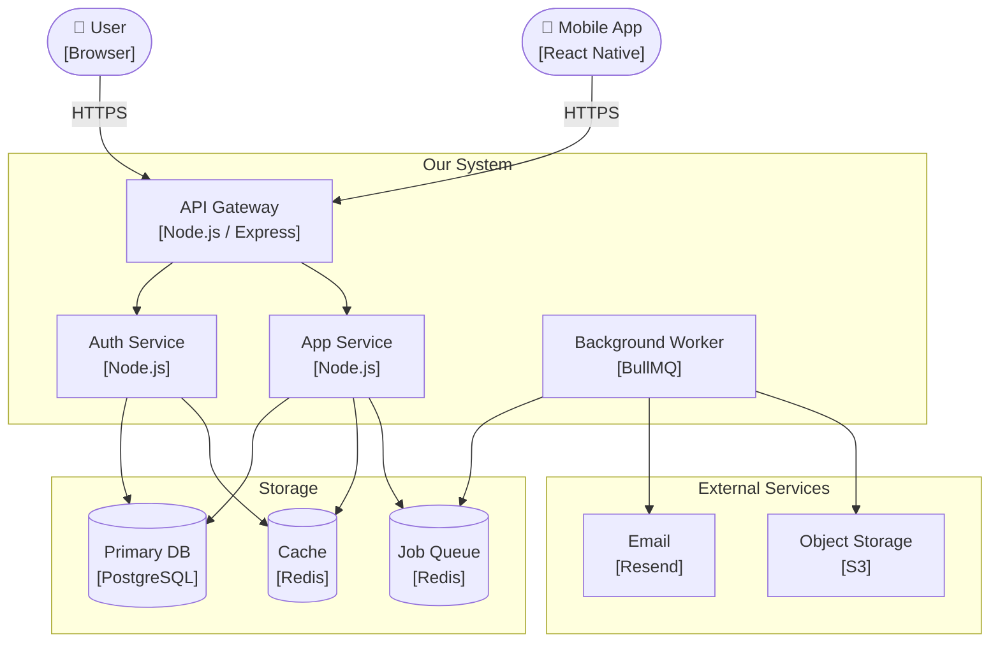

# Architecture Diagram — System Overview

Example of a validated system architecture diagram using flowchart
in a C4-inspired style (Context + Container level).

Related: reference only
Last updated: 2025-01-01

## Notes on this example

- Use `subgraph` to group related components visually
- Label nodes with name + technology in two lines using `\n`
- Use `(["text"])` for external actors (people, external systems)
- Use `[("text")]` for data stores (cylinder shape)
- Label arrows with the protocol or data being exchanged
- Keep to container/service level — do not show internal implementation
