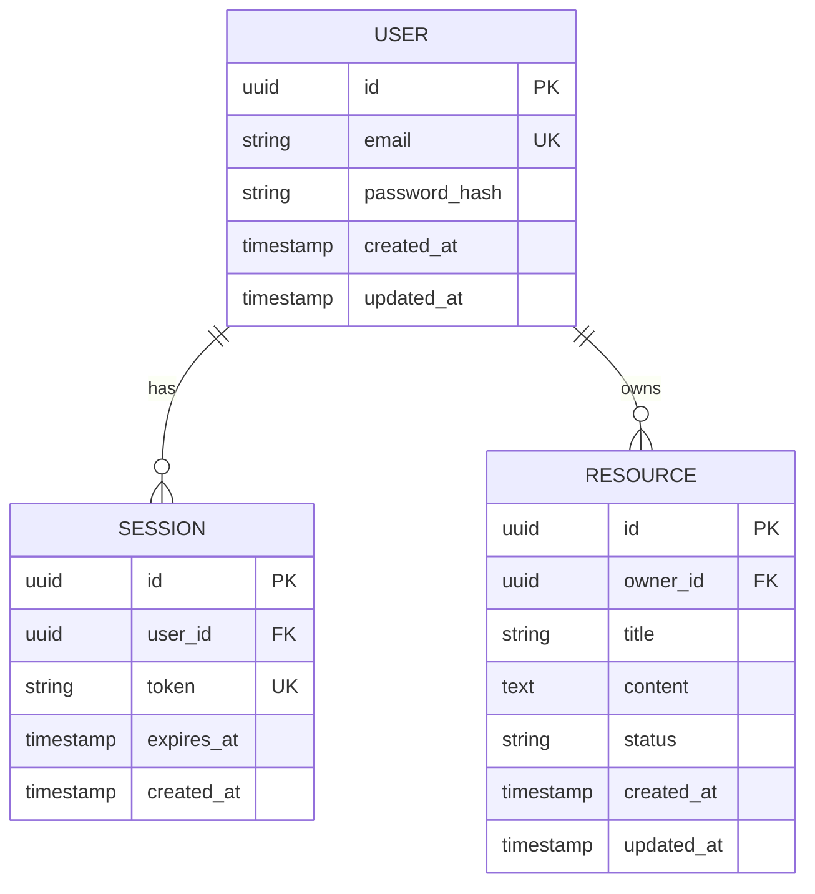

# Entity Relationship Diagram — Basic Schema

Example of a validated ERD showing a common user/resource schema pattern.

Related: reference only
Last updated: 2025-01-01

## Notes on this example

- `PK` marks primary keys, `FK` foreign keys, `UK` unique constraints
- Relationship syntax: `||--o{` means "one to zero-or-many"
- Common cardinality markers:
  - `||` exactly one
  - `o|` zero or one
  - `||--o{` one to zero-or-many
  - `}|--|{` one-or-many to one-or-many
- Keep column types generic: `string`, `uuid`, `text`, `timestamp`, `int`
