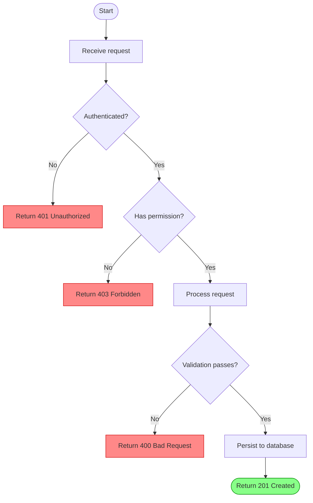

# Flowchart — Decision Branch

Example of a validated flowchart with decision branches and error handling.

Related: reference only
Last updated: 2025-01-01

## Notes on this example

- `([text])` renders a rounded pill — use for start/end nodes
- `{text}` renders a diamond — use for decisions
- `[text]` renders a rectangle — use for actions
- `TD` means top-down; use `LR` for left-to-right layouts
- Style error paths in red and success in green for readability
- Keep decision labels short: "Yes/No" or the condition being checked
