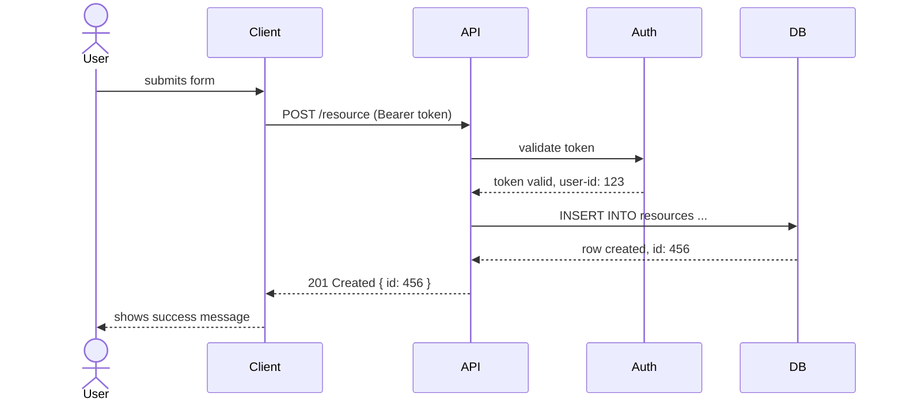

# Sequence Diagram — Request Flow

Example of a validated sequence diagram showing an authenticated API request.

Related: reference only
Last updated: 2025-01-01

## Notes on this example

- `actor` renders a person icon — use for end users
- `participant` renders a box — use for systems and services
- `-->>` denotes a response (dashed line)
- `->>` denotes a request (solid line)
- Avoid more than 6–7 participants — split into two diagrams if needed
