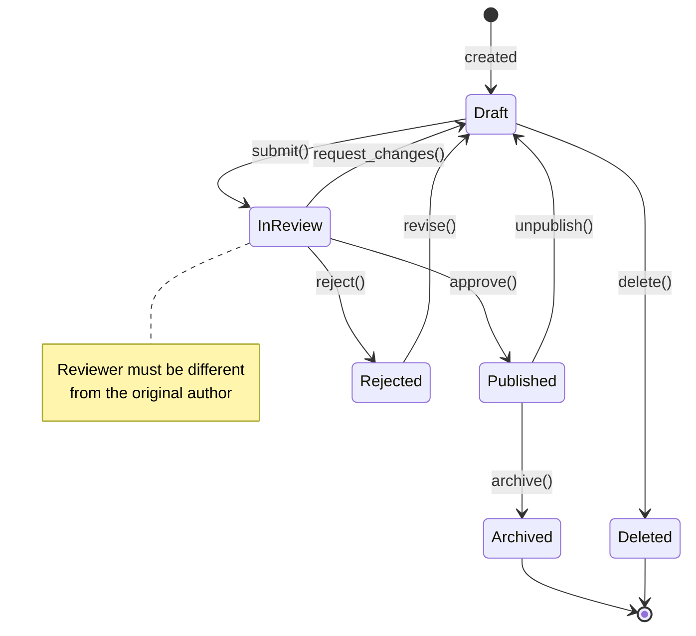

# State Diagram — Resource Lifecycle

Example of a validated state machine showing a resource moving through
a review and publish workflow.

Related: reference only
Last updated: 2025-01-01

## Notes on this example

- Always use `stateDiagram-v2` — `stateDiagram` is deprecated
- `[*]` represents the start and end states
- Transition labels use the format `event()` or plain text
- Use `note` blocks sparingly — only for constraints not obvious from
  the diagram structure
- Avoid more than 8–10 states — split into sub-state diagrams if needed
